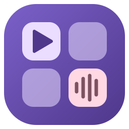

<p align="center">
  
</p>

<h1 align="center">fboard</h1>

<p align="center">A free and open-source soundboard for Linux. Play sounds through your microphone in voice chats and
games, with global hotkeys. A native Linux replacement for Soundpad, with a Material 3 interface.</p>

## Features

**Playback**
- Play to **speakers and microphone**, **speakers only** or **microphone only** (play modes, switchable by hotkey)
- Virtual microphone (`fboard Microphone`) that mixes your real voice with your sounds. It can be the system default
  input while fboard runs, so voice apps work without any setup
- **Volume normalization** (EBU R128), with a "measure my voice" test and optional dynamic adjustment
- **Block voice** (mutes your mic while a sound plays), **hear myself**, voice-activation sound
- Pause/resume (also in another play mode), seek, previous/next, random (category / all / speakers / mic),
  repeat current file, continue playback, repeat sound list

**Hotkeys**
- Global hotkeys on **every desktop**: X11, GNOME, KDE, Hyprland, Sway and any other Wayland compositor
- Keys, key combinations, mouse buttons (middle, 4, 5, modifier+click)
- ~40 special hotkeys (stop, pause, play mode, volume, recorder, categories, toggle hotkeys/Auto Keys…)
- Numcode (hold Alt and type `123` on the numpad) and index hotkeys
- Pass hotkeys through or block them from the focused application, left/right modifiers, auto stop,
  same hotkeys in all categories, hotkey overview

**Organizing**
- Sound list with sortable, resizable, reorderable and hideable columns (tag, duration, hotkey, play count, …)
- Categories and subcategories with custom icons, descriptions and random-file hotkeys
- Hotbar: a grid of buttons with pages, colors and hotkeys
- Instant search (just start typing), drag & drop of files and folders, copy/cut/paste, undo/redo
- Sound lists: new/load/save/save as/recent, automatic working copy, daily backups with restore, export of
  all sound files, export/import of preferences

**Recorder & editor**
- Record "what you hear" (or any input) to M4A, MP3, OGG, Opus, FLAC or WAV, with automatic normalization,
  silence trimming and a time limit, started/stopped by hotkey
- Sound editor: waveform, selection, cut, crop, fade in/out, volume, normalize, silence, undo/redo, zoom

**Auto Keys**
- Presses keys for you while a sound plays (a game's push-to-talk, a mute key in your voice app)
- Hold during the sound, or tap before and after
- Conditions: always, foreground app is fullscreen, a certain app is running, a certain app is in foreground
- Troubleshooting view that tells you why a key didn't fire

**Desktop**
- Material 3 design with light/dark theme and your desktop's accent color
- Tray icon, close to tray, start minimized, single instance
- Acoustic notifications for hotkey actions

## Install

Download from the [releases page](https://github.com/proshiv85-byte/fboard/releases):

| Distribution | Package |
| --- | --- |
| Any distribution | `fboard-*-x86_64.AppImage` |
| Arch Linux | `packaging/aur/PKGBUILD` (`makepkg -si`) |
| Ubuntu 24.04+ / Debian 13 | `fboard_*_amd64.deb` |
| Fedora | `fboard-*.x86_64.rpm` |
| Flatpak | `fboard.flatpak` |

### One-time setup for global hotkeys

fboard reads your keyboard and mouse directly (evdev), which works on every desktop. Your user needs to be in
the `input` group:

```sh
sudo usermod -aG input $USER    # then log out and back in
```

Without it, fboard falls back to X11 key grabs (X11 sessions) or to your desktop's global shortcuts portal
(KDE, GNOME 48+, Hyprland). Packages also install a udev rule that lets you use `/dev/uinput`, which Auto Keys
and hotkey blocking need.

### Using it in voice apps

Select **fboard Microphone** as the input device in Discord, TeamSpeak, Mumble, OBS or your game, or keep
"Default": while fboard runs, its microphone is the system default (Preferences › Devices). Turn off noise
suppression in those apps, since it can cut off sounds.

## Requirements

PipeWire (with `pipewire-pulse`) or PulseAudio, FFmpeg 5.1 or newer, GTK 3.

## Building from source

```sh
# Arch: sudo pacman -S clang cmake ninja pkgconf gtk3 libpulse ffmpeg libx11
# Debian/Ubuntu: sudo apt install clang cmake ninja-build pkg-config libgtk-3-dev libpulse-dev \
#   libavformat-dev libavcodec-dev libavutil-dev libswresample-dev libx11-dev
flutter pub get
flutter build linux --release
./build/linux/x64/release/bundle/fboard
```

`flutter test` runs the unit tests.

## How it works

- `native/` is a small C library loaded with `dart:ffi`:
  - `audio.c`: the PulseAudio client. It creates the `fboard_sink` null sink, the `fboard_mic` source and a
    loopback from your real microphone, and plays sounds through two low-latency streams (speakers and mic).
  - `media.c`: FFmpeg decoding/encoding and BS.1770 loudness measurement.
  - `input.c`: evdev hotkeys (with optional grabbing and re-emission through uinput), X11 key grabs, uinput
    key injection for Auto Keys, and active-window detection on X11.
- `lib/` is the Flutter app: models, the app controller, hotkey/portal/Auto Keys/recorder services, and the
  Material 3 UI.

Your data lives in `~/.local/share/fboard` (working copy, backups, recordings) and `~/.config/fboard`
(preferences). Sound lists are saved as `.fbl` (JSON) files.

## Differences from Soundpad

- No Steam integration, remote control API, text-to-speech or web import.
- Active-window conditions for Auto Keys work on X11, Hyprland and Sway. Other Wayland desktops don't let apps
  see the active window.
- With the portal hotkey backend, your desktop decides the final key binding, and mouse-button and numcode
  hotkeys aren't available.

## License

[GPL-3.0-or-later](LICENSE)
